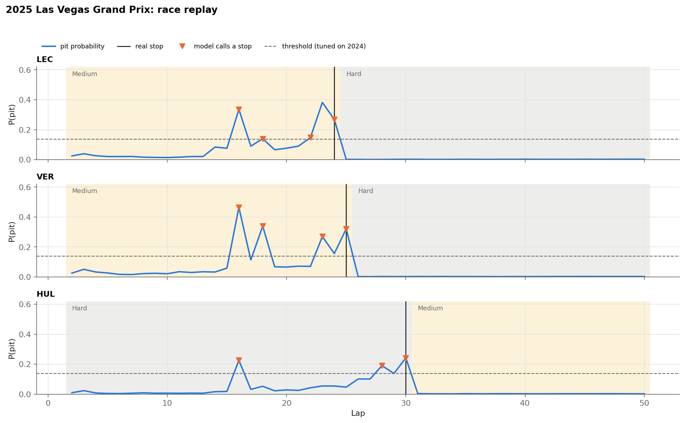
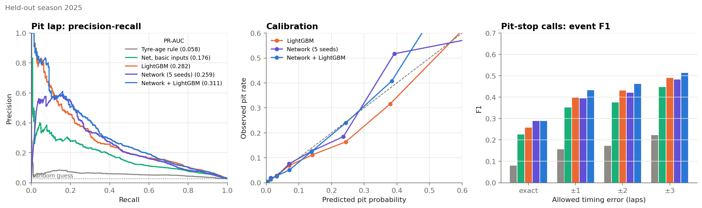
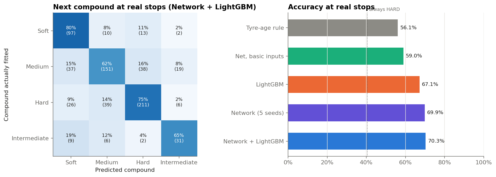

# F1 Pit Stop Strategy Predictor


[](https://colab.research.google.com/github/ssarann/f1-pit-strategy/blob/main/notebooks/f1_pit_strategy.ipynb)

For every lap of a Formula 1 race, the model predicts **whether a driver will pit** and **which tyre compound they will fit**. It is trained on lap timing data from 2019–2023 ([FastF1](https://github.com/theOehrly/Fast-F1)), tuned on 2024 and tested on the full **2025 season**, which it never saw during training.

<p align="center">
  
</p>

*Pit probability for three drivers in a 2025 test race. Black lines are real stops, orange markers are the laps where the model calls a stop.*

## Results

Test season 2025: 24 races, 705 pit stops. A call counts as correct if it is within 2 laps of a real stop.

| Model | Precision | Recall | F1 | Tyre choice accuracy |
|---|---:|---:|---:|---:|
| Rule: pit at the usual stint length | 20.4 % | 14.9 % | 0.17 | 56.1 % |
| Neural network, basic inputs only | 31.6 % | 46.2 % | 0.38 | 59.0 % |
| LightGBM | 37.1 % | 51.6 % | 0.43 | 67.1 % |
| Neural network | 34.1 % | 55.2 % | 0.42 | 69.9 % |
| **Neural network + LightGBM** | **40.6 %** | **53.9 %** | **0.46** | **70.3 %** |

Only 2.7 % of laps are pit laps, so random guessing would reach a precision of about 3 %.

<p align="center">
  
</p>

## How it works

**Data.** One CSV per race with every lap of every driver. Cleaning steps:
- 2018 used absolute compound names (hypersoft to superhard). They are ranked within each race and renamed Soft, Medium and Hard, like in later seasons.
- Pit entries that are not tyre stops are removed: retirements, drive-through penalties and safety-car laps routed through the pit lane.

**Features.** Everything is computed from laps that are already finished, so the model never uses information from the future:

| Group | Examples |
|---|---|
| Tyres | tyre age, compound, compounds used so far, whether a second dry compound is still required |
| Pace | lap-time loss compared to the best lap of the stint, how fast that loss is growing |
| Rivals | gaps to the cars ahead and behind, whether they just pitted, how many cars have already stopped |
| Race status | safety car or virtual safety car, laps remaining |
| Weather | rain, lap-time difference between cars on intermediates and on slicks |
| Circuit history | usual stint length and pit-lane time loss at this circuit in earlier seasons |

**Model.** A neural network (PyTorch) with two outputs: the probability of a stop on this lap and the next tyre compound. Five copies are trained with different random seeds and averaged, then combined with a LightGBM model trained on the same features.

**Evaluation.** Seasons are split by year (train 2019–2023, validation 2024, test 2025). Early stopping and the decision threshold are chosen on 2024 only, so the 2025 numbers are a clean estimate.

## Tyre choice

<p align="center">
  
</p>

The biggest single improvement came from knowing which compounds the rest of the field has switched to in the same race. Most errors are between the three dry compounds.

## Limitations

- About 60 % of the calls are false alarms, mostly a few laps before the real stop. The model sees that the pit window is open but often not the exact lap.
- Stops caused by damage or a sudden safety car cannot be predicted from lap data.
- The model sees the safety car status of the current lap as race control shows it live. Without it, the results are lower.
- Tyre sets left for the race and team radio are not in the data.

## Running the notebook

1. Click the **Open in Colab** badge, choose a GPU runtime and run all cells.
2. On the first run the notebook downloads about 170 races through FastF1 into Google Drive. The API allows about 500 requests per hour, so the download may need to be resumed. Later runs take about 5 minutes.

To run it locally, set `F1_PROJECT_DIR` to a folder for the data and install the dependencies:

```bash
git clone https://github.com/ssarann/f1-pit-strategy.git
cd f1-pit-strategy
pip install -r requirements.txt
jupyter notebook notebooks/f1_pit_strategy.ipynb
```

## Repository structure

```
f1-pit-strategy/
├── notebooks/
│   └── f1_pit_strategy.ipynb   # data, features, training, evaluation
├── docs/img/                   # figures used in this README
├── requirements.txt
├── LICENSE
└── README.md
```

## License

Released under the [MIT License](LICENSE). Timing data from [FastF1](https://github.com/theOehrly/Fast-F1). This project is not affiliated with Formula 1 or the FIA.
