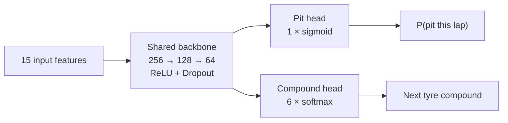
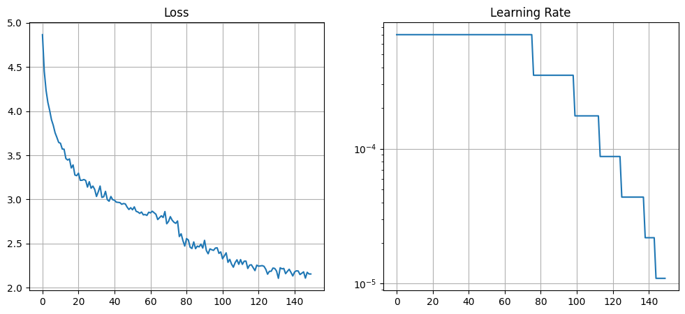
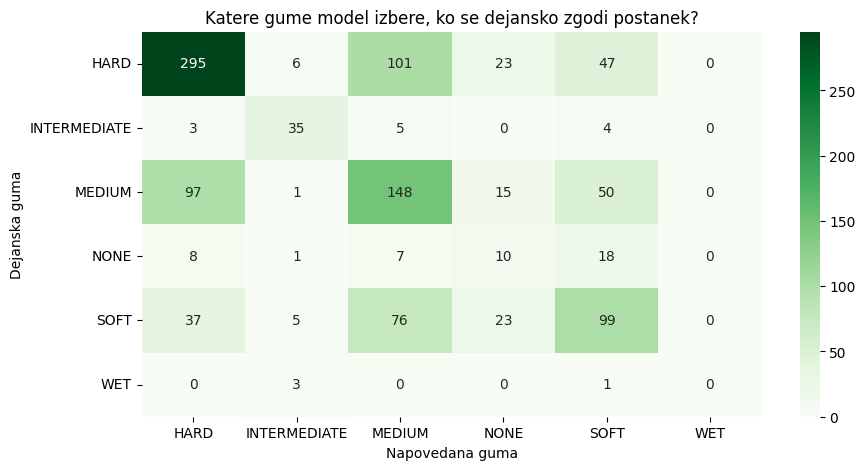
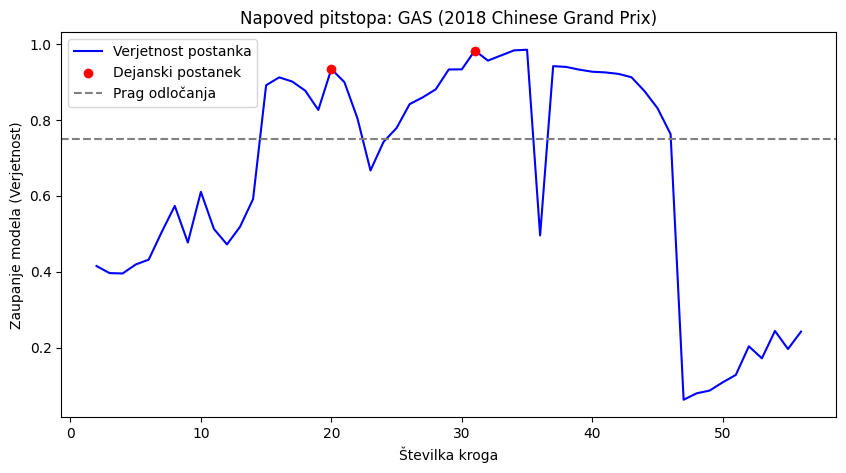

# F1 Pit Stop Strategy Predictor


[](https://colab.research.google.com/github/ssarann/f1-pit-strategy/blob/main/notebooks/f1_pit_strategy.ipynb)

A multi-task neural network (PyTorch) that predicts, lap by lap, **whether a Formula 1 driver will pit** and **which tyre compound they will switch to**. It is trained on eight seasons (2018–2025) of lap-level timing data from [FastF1](https://github.com/theOehrly/Fast-F1) and evaluated on **held-out races**.

The focus of the project is not only the model but also an honest evaluation: race-level data splitting, features that only use information available at the start of a lap, and a candid discussion of where the model fails.

---

## Results at a glance

| Task | Metric | Result |
|---|---|---|
| Pit timing | Window precision / recall / F1 (threshold 0.75) | **42.9 % / 64.0 % / 0.513** |
| Tyre compound at an actual stop | 6-class accuracy | **52.5 %** (always predicting HARD: 42.2 %) |
| Alarm quality | Share of flagged laps within ±2 laps of a real stop | **29.1 %** |

Window-level counts on the test races: 710 true positives, 946 false alarms, 400 missed stops. All numbers come from races the model never saw during training. See [Limitations](#limitations) before interpreting them.

---

## Problem

During a race, a team decides each lap whether to bring the driver in and which tyres to fit. This project asks how much of that decision can be predicted from the driver's own lap history alone:

1. **Pit head** – binary classification: is this lap a pit lap?
2. **Compound head** – 6-class classification: which compound is fitted next (`SOFT`, `MEDIUM`, `HARD`, `INTERMEDIATE`, `WET`, `NONE`)?

Both tasks share one representation, so the network learns tyre-wear and race-phase features once and uses them for both outputs.

## Data

- **Source:** FastF1, seasons 2018–2025, roughly 170 Grands Prix and about 180k driver-laps.
- **Sample:** one driver-lap, described by a 15-dimensional feature vector.
- **Features (15):**
  - *Race context:* lap number, race progress, laps remaining, previous-lap position
  - *Tyres:* current compound, tyre life, stint length
  - *Pace:* previous-lap time, degradation proxy (previous-lap time minus the stint's best lap so far)
  - *Track conditions:* safety-car flag, virtual-safety-car flag, air temperature, track temperature, rainfall
- **Targets:** `PitThisLap` (binary) and the compound of the following lap (6 classes). On a pit lap this is the newly fitted compound. `NONE` marks an unknown compound or a driver with no following lap, for example a retirement in the pits.

Raw data are downloaded on the first run and cached locally; they are not stored in this repository.

## Model



| Component | Setting |
|---|---|
| Backbone | 256 → 128 → 64, ReLU, dropout 0.3 / 0.2 |
| Pit loss | Weighted binary cross-entropy, `pos_weight = 60` |
| Compound loss | Masked cross-entropy (only pit laps contribute), weight λ = 3.0 |
| Optimiser | Adam, lr = 7·10⁻⁴ |
| Scheduler | `ReduceLROnPlateau` (factor 0.5, patience 5) |
| Training | 150 epochs, seed 42 |
| Decision threshold | 0.75 |

## Evaluation methodology

Pit stops are rare events and consecutive laps of the same race are strongly correlated, so a naive evaluation is easily over-optimistic. The following measures were taken:

- **Race-level split.** `GroupShuffleSplit` on *season + Grand Prix* (80 / 20, seed 42): no lap of a test race appears in training. An earlier iteration of this project split at row level, which let laps of the same race land on both sides; those results were discarded.
- **Causal features.** Quantities such as the best lap of the stint are computed as a running minimum, so no lap sees its own future.
- **Training-only statistics.** Class weights for the compound head are computed on the training split only.
- **Fixed seeds** for reproducibility.

## Results

### Training



The combined training loss falls from about 4.9 to 2.2 over 150 epochs while the scheduler halves the learning rate six times. The curve shows training loss only; the project does not yet track a validation curve (see [Limitations](#limitations)).

### Tyre compound at the moment of a stop



*Figure labels are in Slovenian: rows are the actual compound, columns the predicted one.*

Of 1,118 actual stops in the test races, 587 are classified correctly (52.5 %). The model beats the majority-class baseline of always predicting `HARD` (42.2 %). Per-class recall:

| Actual compound | Stops | Recall |
|---|---:|---:|
| HARD | 472 | 62.5 % |
| MEDIUM | 311 | 47.6 % |
| SOFT | 240 | 41.3 % |
| INTERMEDIATE | 47 | 74.5 % |
| NONE | 44 | 22.7 % |
| WET | 4 | 0 % |

Most errors are confusions between the three dry compounds, mainly `HARD` ↔ `MEDIUM`. `NONE` and `WET` have very few examples, so their numbers are not reliable.

### Example: a held-out race



*Driver GAS, 2018 Chinese Grand Prix (test set). Blue: predicted pit probability; red dots: actual stops; dashed line: decision threshold 0.75.*

Both real stops (laps 20 and 31) lie in a region where the model is confident, so the stint structure is captured. The plot also shows the main weakness: the probability stays above the threshold for many consecutive laps, producing a broad alarm region instead of a sharp peak at the stop.

## Limitations

- **Over-alarming.** At lap level the model flags 4,643 laps as pit laps, against 1,118 actual stops in the test races. Consecutive alarms around one stop are not merged by any post-processing yet.
- **Uncalibrated probabilities.** The large `pos_weight` inflates raw outputs, so the values are scores, not true likelihoods.
- **Threshold chosen manually.** 0.75 was fixed by hand and not tuned on a separate validation split, so test metrics may be mildly optimistic.
- **Limited information.** The model sees the driver's own lap history, coarse weather and safety-car flags, but not gaps to other cars, traffic, tyre-set availability or team strategy. These trigger many real stops, which sets a ceiling on achievable accuracy.
- **Safety-car flags are not strictly causal.** `IsSafetyCar` and `IsVSC` are derived from the track status of the *current* lap, which is only fully known at the end of that lap. They can therefore carry information that a real-time system would not have at decision time.
- **No baselines yet.** Apart from the majority-class compound baseline, the model is not compared with simpler models such as logistic regression or gradient boosting.
- **Single run.** One seed and one split, so there are no confidence intervals.
- **Small classes.** `WET` and `NONE` have too few test examples for stable estimates.

## Future work

- Baselines: logistic regression, gradient-boosted trees and a rule-based heuristic; report PR-AUC, which does not depend on a threshold.
- Select the threshold on a validation split and add a validation loss curve with early stopping.
- Post-processing: keep only the highest-probability lap in each cluster of consecutive alarms.
- Reformulate the target as "pit within the next *k* laps", which matches the ±2-lap strategic metric better.
- Add safety-car, weather and gap-to-rival features.
- Grouped k-fold cross-validation by race for confidence intervals.

## Reproducing the results

The notebook is written for **Google Colab**: it mounts Google Drive to cache the FastF1 downloads and the processed race files.

1. Click the *Open in Colab* badge at the top.
2. Run all cells from the top and allow the Drive mount.

The first run downloads about 170 races through FastF1 (the API has an hourly request limit, so it may need to be resumed) and takes a while. Processed races are checkpointed to Drive. A GPU is optional.

To run locally, remove the `google.colab` import and the `drive.mount` call, point `BASE_DIR` to a local folder and install the dependencies:

```bash
git clone https://github.com/ssarann/f1-pit-strategy.git
cd f1-pit-strategy
pip install -r requirements.txt
jupyter notebook notebooks/f1_pit_strategy.ipynb
```

## Repository structure

```
f1-pit-strategy/
├── notebooks/
│   └── f1_pit_strategy.ipynb   # data processing, training, evaluation
├── docs/img/                   # figures used in this README
├── requirements.txt
├── LICENSE
└── README.md
```

## Acknowledgements and disclaimer

Timing data are accessed through the open-source [FastF1](https://github.com/theOehrly/Fast-F1) library. This is an independent educational project and is not affiliated with or endorsed by Formula 1, the FIA or any team.

## License

Released under the [MIT License](LICENSE).

## Author

**Amar Šaranović** – MSc student in Electrical Engineering (Automation and Informatics), University of Ljubljana, Faculty of Electrical Engineering.
GitHub: [@ssarann](https://github.com/ssarann)
